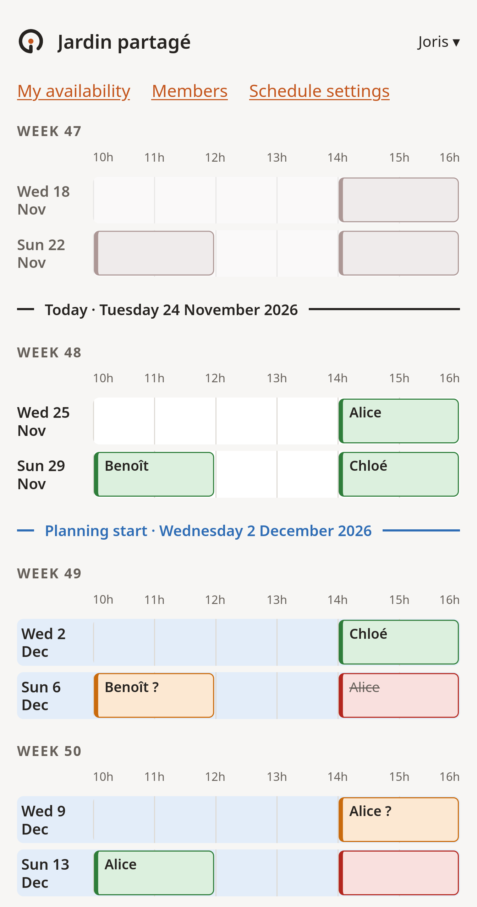
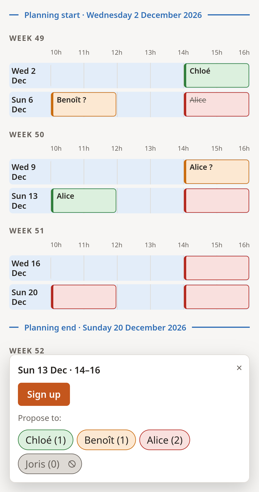

# Gilda

**Volunteer scheduling for small associations.**

Gilda helps an association answer one question: *who is on duty next
Sunday?* The interface speaks English and French and works on mobile.

<p align="center">
  
  &nbsp;&nbsp;
  
</p>

## What it does

- **A weekly schedule.** Define the recurring slots of your association
  plus closures for holidays. Gilda lays them out week after week.
- **At a glance.** Each slot is green when filled, orange when a
  volunteer is only proposed, and red when nobody is there yet.
- **Members and roles.** Managers add members, set their roles and can
  send an access link to a member. Signing in with a password works too.
- **Availability.** Every member sets their preferences per slot, adds
  absences, and leaves a note for the managers.
- **Sign up in a tap.** Members can take an open slot themselves, and
  cancel whenever they need to.
- **Easy filling for managers.** To propose a slot, the managers see
  the members sorted by preference and by the shifts they already
  have, so the load stays balanced. Absences and notes are shown.

## Try it locally

You need Docker (for PostgreSQL and a local mail catcher), Python 3.13
and `uv`. Everything goes through `make`; `make help` lists the
targets.

```sh
make install      # dependencies of every part
make dev          # PostgreSQL, migrations, then the backend with reload
```

Then open http://localhost:8000. Emails sent in development (account
confirmation, access links) are caught by Mailpit at
http://localhost:18025.

## Deploy

See [DEPLOY.md](DEPLOY.md).

## Under the hood

- `backend/`: the web interface, in Python (Litestar, Advanced
  Alchemy, PostgreSQL, Jinja, Datastar).
- `e2e/`: end-to-end tests with Playwright.
- `compose.yaml`: PostgreSQL for development (`localhost:5432`) and for
  the tests (`localhost:15432`), user and password `gilda`, and Mailpit
  (SMTP on port 11025).

## Dev43 process

The development process is [Dev43](https://github.com/joris-r/dev43). The specification of the software
lives in [docs/](docs/README.md).

The Dev43 process keeps the specification accurate and alive, traces
every requirement into the test suite, and covers security too.
